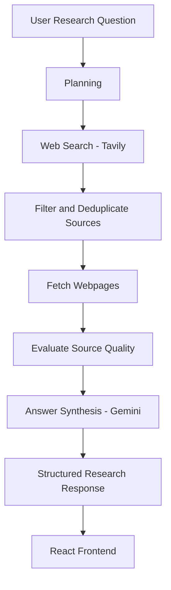

# Predixion AI Research Agent

A production-oriented AI research agent built using **Python, FastAPI, LangGraph, Gemini, and Tavily**. It accepts research questions, creates an execution plan, gathers information from the web, evaluates retrieved evidence, and generates structured research reports with sources, confidence levels, assumptions, and limitations.

## Live Application

**Frontend:** https://predixion-ai-research-agent.vercel.app/

**Backend API:** https://predixion-ai-research-agent-api.onrender.com

**API Documentation:** https://predixion-ai-research-agent-api.onrender.com/docs

The application can be used directly through the live frontend without local installation or API key configuration.

## Features

- Research question understanding and planning.
- Web search using Tavily.
- Source filtering and duplicate removal.
- Webpage retrieval and content extraction.
- Source-quality evaluation.
- Evidence-based answer synthesis using Gemini.
- Structured research reports.
- Confidence, assumptions, and limitations reporting.
- Execution tracing and basic failure handling.
- Fallback to search snippets when webpage retrieval fails.

## Architecture

The application uses LangGraph to orchestrate a sequential research workflow.



### Workflow

1. **Planning:** Creates a structured research plan based on the user's question.
2. **Web Search:** Uses Tavily to retrieve relevant search results.
3. **Source Filtering:** Removes duplicate and incomplete search results and selects sources for retrieval.
4. **Webpage Fetching:** Retrieves webpage content using HTTPX and extracts readable text using BeautifulSoup.
5. **Source Evaluation:** Evaluates evidence relevance and content quality, identifying weak or snippet-based evidence.
6. **Answer Synthesis:** Uses Gemini to generate a structured response grounded in retrieved evidence.

LangGraph manages the workflow state and execution between these stages.

## Technology Stack

| Component | Technology |
|---|---|
| Frontend | React, Vite |
| Backend | Python, FastAPI |
| Agent Orchestration | LangGraph |
| Language Model | Google Gemini |
| Web Search | Tavily |
| HTTP Requests | HTTPX |
| Content Extraction | BeautifulSoup |
| Data Validation | Pydantic |
| Testing | Pytest |
| Frontend Hosting | Vercel |
| Backend Hosting | Render |

## Tools and Their Purpose

- **Tavily:** Searches the web and retrieves relevant research results.
- **HTTPX:** Handles asynchronous webpage requests with timeout and retry behaviour.
- **BeautifulSoup:** Extracts readable webpage content.
- **Gemini:** Synthesizes retrieved evidence into structured research answers.
- **LangGraph:** Controls the research workflow and passes state between execution stages.

## Reliability and Failure Handling

The system includes basic production-oriented safeguards:

- Timeout and retry handling for transient network and API failures.
- Validation and filtering of malformed search results.
- Duplicate URL removal.
- URL validation to reject localhost and private network destinations.
- Search-snippet fallback when webpage retrieval fails.
- Source-quality evaluation to identify weak or incomplete evidence.
- Structured response validation using Pydantic.
- Retrieved webpage content is treated as untrusted input to reduce prompt-injection risks.
- Execution traces record successful and failed workflow operations.

When evidence is incomplete, the system reports limitations and adjusts confidence rather than presenting every result as fully verified.

## Running Locally

You can also clone and run the complete project locally instead of using the deployed application.

### Prerequisites

- Python 3.12+
- Node.js and npm
- Gemini API key
- Tavily API key

### 1. Clone the repository

```bash
git clone https://github.com/Sumit182004/predixion-ai-research-agent.git
cd predixion-ai-research-agent
```

### 2. Configure the backend

```bash
cd backend
python -m venv .venv
```

Activate the environment:

Windows:

```powershell
.venv\Scripts\activate
```

Install dependencies:

```bash
pip install -r requirements.txt
```

Create a `.env` file inside the backend directory:

```env
GEMINI_API_KEY=your_gemini_api_key
TAVILY_API_KEY=your_tavily_api_key
GEMINI_MODEL=gemini-3.6-flash
```

Use your own valid API credentials. Never commit the `.env` file.

Start the backend:

```bash
uvicorn app.main:app --reload
```

Backend runs at:

`http://127.0.0.1:8000`

API documentation:

`http://127.0.0.1:8000/docs`

### 3. Configure the frontend

Open another terminal:

```bash
cd frontend
npm install
npm run dev
```

For local frontend usage, configure the API URL in `frontend/src/App.jsx` to:

```javascript
const API_URL = "http://localhost:8000";
```

Open:

`http://localhost:5173`

For the deployed application, the frontend uses the hosted Render backend.

## Evaluation and Testing

The project includes automated tests covering:

- URL validation.
- Missing API key handling.
- Webpage retrieval failures and timeouts.
- Source-quality evaluation.
- Malformed and duplicate evidence.
- Synthesis response validation.
- Prompt-injection-aware prompt construction.
- Structured response evaluation.
- LangGraph workflow execution and failure handling.

Run the tests from the backend directory:

```bash
pip install -r requirements-dev.txt
pytest -v
```

See `EVALUATION.md` for test queries, expected behaviour, observed results, and evaluation findings.

## Design Decisions and Trade-offs

**Why an agentic approach?**

Research involves multiple dependent operations, including planning, searching, filtering, retrieving, and evaluating information. An orchestrated workflow makes these stages explicit and provides visibility into execution.

**Why LangGraph?**

LangGraph provides structured state management and explicit workflow orchestration. It makes the research stages easier to inspect, test, and extend.

**Why these tools?**

Tavily provides web search, HTTPX and BeautifulSoup handle webpage retrieval and extraction, and Gemini performs evidence-based synthesis. This keeps search, retrieval, and answer generation as separate responsibilities.

**Why a sequential workflow instead of multiple agents?**

The research task can be handled through clearly defined stages. A sequential single-agent workflow keeps the implementation understandable and avoids unnecessary multi-agent complexity.

**Key trade-offs**

- Search snippets provide a fallback when full webpage retrieval is unavailable, but they contain less evidence than complete pages.
- Limiting the number of retrieved sources helps control latency and API usage, but may reduce source diversity.
- Confidence is based partly on heuristic source-quality evaluation rather than independent verification of every factual claim.
- External API dependencies introduce latency, availability, and usage-cost considerations.

## Known Limitations

- Some websites block automated webpage retrieval.
- Search snippets may be used when full webpage content cannot be accessed.
- Retrieved sources may not always provide balanced coverage of every aspect of a research question.
- Source-quality scoring uses heuristic evaluation.
- Claim-level citation verification is not currently implemented.
- Research quality and availability depend on external search and LLM APIs.

## Future Improvements

- Improved source diversity and research coverage.
- Claim-level citation verification.
- Research result caching and cost optimization.
- More extensive evaluation datasets.
- Persistent research history.
- Production monitoring and observability.

## Project Structure

```text
predixion-ai-research-agent/
│
├── backend/
│   ├── app/
│   │   ├── agent.py
│   │   ├── evaluator.py
│   │   ├── graph_state.py
│   │   ├── graph_workflow.py
│   │   ├── main.py
│   │   ├── planner.py
│   │   ├── schemas.py
│   │   └── tools.py
│   │
│   ├── tests/
│   ├── .env.example
│   ├── requirements.txt
│   └── requirements-dev.txt
│
├── frontend/
│   ├── src/
│   │   ├── App.jsx
│   │   ├── App.css
│   │   └── index.css
│   ├── package.json
│   └── vite.config.js
│
├── README.md
└── EVALUATION.md
```

## License

This project was developed as part of the Predixion AI Startup Intern assignment.